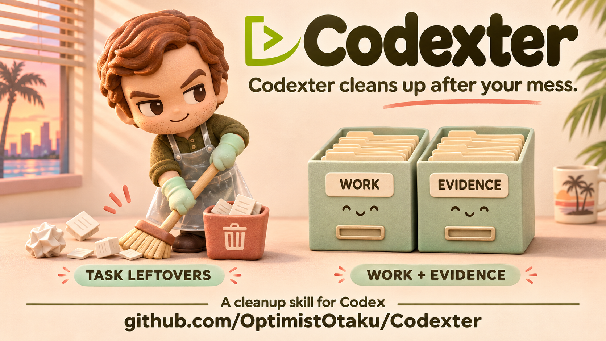

[](https://github.com/OptimistOtaku/Codexter)

# Codexter

[](https://github.com/OptimistOtaku/Codexter/actions/workflows/test.yml)
[](LICENSE)

Codexter ships the `$codex-cleanup` skill for Codex: clean up task leftovers while preserving work and evidence.

**Clear the leftovers. Keep the work.** Preview deletion, clean verified task-owned resources, and preserve deliverables and diagnostic evidence with an audit receipt.

**This is resource hygiene, not a repair for an internal Codex memory leak.** Closing a task-owned browser or test server can release resources. Deleting disk caches does not repair a live application's heap. No RAM-saving claims or benchmarks are made.

## Install

**One command, the same on macOS, Linux, and Windows PowerShell:**

```sh
gh skill install OptimistOtaku/Codexter codex-cleanup --agent codex --scope user
```

Requires a recent [GitHub CLI](https://cli.github.com/) with `gh skill install` support. Sign in with `gh auth login` if requested. The native skill command is currently a GitHub CLI preview. It installs this skill for Codex across projects, handles folder placement, and records its source for updates. No repository clone, Node.js, or administrator privileges are needed.

**Already inside Codex? Paste this one-line prompt instead:**

```text
$skill-installer install https://github.com/OptimistOtaku/Codexter/tree/main/skills/codex-cleanup
```

That is a Codex prompt, not a terminal command. The two methods are alternatives; install once to avoid duplicate skill entries. Codex detects new skills automatically; if the skill does not appear, restart Codex.

To update an installation managed by GitHub CLI:

```sh
gh skill update codex-cleanup
```

For project-only installation, previews, pinned versions, the `npx skills` alternative, or manual installation, see [installation options](docs/INSTALLATION.md). See the official [GitHub install manual](https://cli.github.com/manual/gh_skill_install) and [Codex skill documentation](https://learn.chatgpt.com/docs/build-skills).

The helper requires Python 3.10+ and Git on PATH, with no third-party Python packages. Runtime cleanup uses whatever supported tools are available in the current task.

## Use in Codex

At the start of resource-heavy work:

```text
Use $codex-cleanup to track temporary resources for this task, then clean up after validation. Preserve outputs and failure evidence.
```

At wrap-up:

```text
Use $codex-cleanup now. Release resources owned by this task, preserve evidence, preview file deletion, and clean the disposable leftovers.
```

For routine use after other skills, adopt the optional [AGENTS.md integration](docs/INTEGRATION.md). Automatic skill discovery alone does not guarantee invocation after every task, and interrupted tasks may need a later cleanup pass. This package installs no hooks or background service.

## What it cleans and preserves

| Resource | Behavior |
| --- | --- |
| Scratch files and disposable caches | Delete only inside a freshly initialized run's `temp/` and `cache/`, after preview and revalidation. |
| Test servers, browser contexts, containers, REPL sessions | Agent uses supported teardown only with verified exclusive ownership. The file helper does not stop processes. |
| Deliverables and validation/failure evidence | Preserve. Evidence, plans and receipts have no automatic expiry. |
| Explicit keeps and Git-tracked files | Preserve, including tracked files accidentally created inside a disposable tree. |
| Unknown old temp files, other tasks, user tabs, shared runtimes/caches | Leave intact and report separately. |
| Codex history, databases, auth, skills/plugins, source, dependencies | Outside cleanup scope. |

## Helper example

Run these from this repository root, substituting an existing absolute workspace and a fresh run ID:

```text
python skills/codex-cleanup/scripts/cleanup.py init --workspace /absolute/project --run task-42
```

Write task scratch data only into the returned `temp`/`cache` paths, and retain evidence in the returned `evidence` path or your chosen output directory. Finish writers and copy any required evidence before planning:

```text
python skills/codex-cleanup/scripts/cleanup.py plan --workspace /absolute/project --run task-42 --keep temp/repro
```

Review the JSON report, then apply using its returned `plan` ID:

```text
python skills/codex-cleanup/scripts/cleanup.py apply --workspace /absolute/project --run task-42 --plan <returned-plan-id>
```

On Windows use an absolute Windows workspace path and quote paths containing spaces. `py -3` can substitute for `python`. See [helper details](skills/codex-cleanup/references/helper.md) for retention, failures and recovery.

Deletion is permanent. The helper rejects observed symlinks, Windows reparse points, hard links, special files, nested Git metadata, stale plans and ambiguous Git state. It rechecks paths, but requires a trusted quiescent workspace; it is not an adversarial filesystem security boundary. Reported bytes are logical file lengths, not measured physical disk space or RAM recovered.

## Development and validation

```text
python -B -m unittest discover -s tests -v
```

Tests use isolated temporary fixtures. Git must be available. Symbolic-link tests may skip when OS privileges prevent creating a fixture; junction tests run on Windows. CI is configured for Windows, macOS and Linux with Python 3.10 and 3.13. See [validation evidence](docs/VALIDATION.md) for what has actually run.

The installation smoke check uses GitHub CLI to install into an isolated directory, checks that supporting files survive installation, and runs the installed helper through a real cleanup while preserving evidence:

```text
python -B tests/install_smoke.py
```

- [Research and source limitations](docs/RESEARCH.md)
- [Implementation plan](PLAN.md)
- [Skill instructions](skills/codex-cleanup/SKILL.md)
- [Runtime cleanup ownership rules](skills/codex-cleanup/references/runtime-cleanup.md)
- [Release and X drafts](docs/LAUNCH.md)

MIT licensed. Independent community project; not affiliated with or endorsed by OpenAI.
